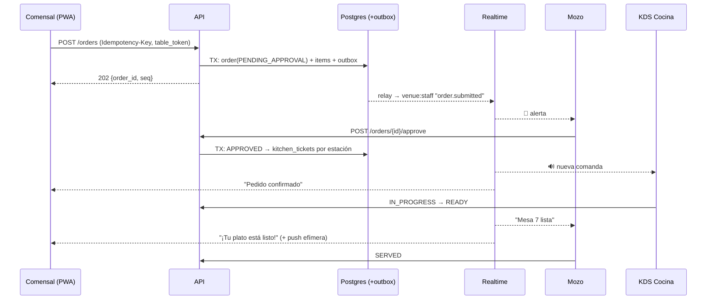
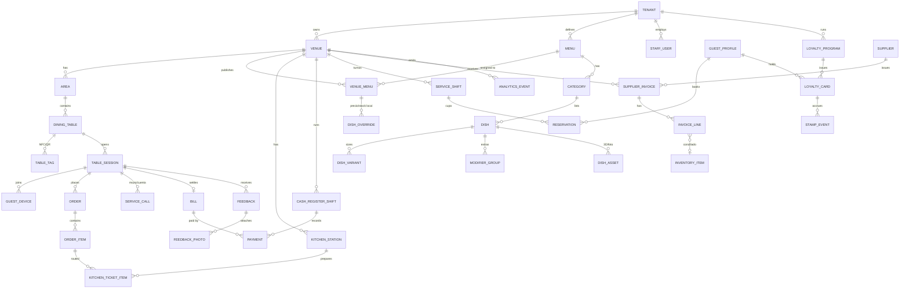

# 🍽️ Plan Maestro: Plataforma de Experiencia en Mesa (Bar)

Base de conocimiento del proyecto **bar**: une una carta interactiva 3D/AR con sistema operativo gastronómico (estilo *Menuly*) y un hub en mesa "zero-install" con NFC + QR (estilo *Candour*).

> **Estado (21/10/2026): MVP completo andando en local.** Con `INICIAR-MVP.cmd` arranca todo y se abre desde el celular (Wi-Fi o HTTPS). Hay carta 3D/AR, pedidos, mozo, KDS, **admin del bar** (carta, agotados, fotos/3D, mesas y QR, equipo, Wi-Fi, reseñas), **super admin** de la plataforma, Sudoku para la espera y una auditoría de seguridad hecha ([docs/SEGURIDAD.md](docs/SEGURIDAD.md)). Falta el deploy en la nube. Ver [§11](#11-estado-actual-qué-está-hecho-y-qué-falta).
>
> Este documento es la fuente de verdad: cada decisión nueva se agrega acá o como ADR en `docs/adr/`. Repo: https://github.com/NicBazan/bar

---

## Índice

0. [Contexto del Portafolio y qué reutilizamos](#0-contexto-del-portafolio-y-qué-reutilizamos)
1. [Stack tecnológico](#1-stack-tecnológico)
2. [Estrategia "no-app pero sí-app"](#2-estrategia-no-app-pero-sí-app)
3. [Pipeline 3D y WebAR](#3-pipeline-3d-y-webar)
4. [Motor de tiempo real](#4-motor-de-tiempo-real)
5. [Modelo de datos multi-tenant](#5-modelo-de-datos-multi-tenant)
6. [IA y seguridad en mesa](#6-ia-y-seguridad-en-mesa)
7. [Roadmap por fases](#7-roadmap-por-fases)
8. [Estructura de carpetas](#8-estructura-de-carpetas)
9. [Convenciones y cómo correrlo](#9-convenciones-y-cómo-correrlo)
10. [API implementada](#10-api-implementada)
11. [Estado actual: qué está hecho y qué falta](#11-estado-actual-qué-está-hecho-y-qué-falta)
12. [Problemas conocidos y soluciones](#12-problemas-conocidos-y-soluciones)
13. [Historial](#13-historial)

---

## 0. Contexto del Portafolio y qué reutilizamos

Proyectos hermanos en `Portafolio/`:

| Proyecto | Repo | Stack | Qué tomamos para **bar** |
| :-- | :-- | :-- | :-- |
| **Enterprice-portafolio** | `agustinamade6-dev/Enterprice-portafolio` | Next.js 16, React 19, TS, Tailwind v4, Zod, jose, Cloudflare | Base del **frontend**: Next.js App Router, Tailwind v4, validación con Zod, JWT con `jose`, headers estrictos (`_headers`), validación de uploads (sin SVG/HTML). |
| **taller (LV Racing)** | `NicBazan/lv-racing-web` | FastAPI, SQLAlchemy async, Jinja2, SlowAPI, Vercel | Lecciones de **seguridad y mobile**: cookies `HttpOnly` borradas solo desde el servidor, `overflow-x: clip`, guards en el servidor, rate limiting, ocultar Swagger en producción, estáticos fuera de Python (ver `taller/LECCIONES-APRENDIDAS.md`). |
| **crm-frontend** | `NicBazan/crm-frontend` | React 19 + Vite + Tailwind v4 | Patrones de panel (tablas, Kanban) para el admin, KDS y mozo. |
| **chatbot** | `NicBazan/CRM` | FastAPI + Alembic + Pytest | Experiencia con asistentes conversacionales, que sirve de referencia para el Chef IA. |
| **todo suela** | `NicBazan/Todo-suela` | FastAPI + Docker + Render | Referencia de deploy con Docker y Render. |
| **leading-page** | `agustinamade6-dev/leading-page` | HTML + video, scroll | Ideas de landing comercial (scrollytelling) para vender el producto. |

**Decisión:** el ecosistema fuerte en frontend es **Next.js + TS** (Enterprice). Por eso **bar** es un **monorepo TypeScript** de punta a punta: comparte tipos entre API, PWA y paneles. Python (FastAPI) queda solo como opción para workers de IA o 3D si alguna librería lo exige.

---

## 1. Stack tecnológico

### Arquitecturas evaluadas

| Criterio | **A. Monolito modular TS + realtime gestionado** ✅ | B. Microservicios (Go/Elixir + K8s) | C. BaaS puro (Firebase/Supabase) |
| :-- | :-- | :-- | :-- |
| Time-to-market | Muy alto | Bajo | Muy alto |
| Latencia en mesa | Buena (edge + CDN) | Excelente | Media (cold starts, lógica en el cliente) |
| Costo con 10 locales | Muy bajo | Alto | Muy bajo |
| Costo con 2.000 locales | Bajo/medio | Medio | Impredecible |
| Transacciones (cupos, caja, comandas) | Fuerte (Postgres) | Fuerte | Débil |
| Lock-in | Bajo | Bajo | Alto |

**Por qué A:** el problema no es de CPU. Lo que importa es la **consistencia transaccional** (cupos, comandas sin duplicar, caja) y **iterar rápido con locales reales**. B es sobre-ingeniería hasta superar unos 5k locales.

### Stack ganador

| Capa | Elección |
| :-- | :-- |
| Web comensal (PWA) | **Next.js (App Router)**, carta en ISR/estático en CDN, Service Worker offline |
| Paneles (mozo, KDS, admin, caja) | Next.js en una app separada del monorepo, KDS como PWA en modo kiosco |
| Nativo | **App Clip iOS (SwiftUI)**, un shell fino con WebView. **Android sin binario** (Google Play Instant fue discontinuado en 2025) |
| Backend | **Node.js + TypeScript (NestJS o Fastify)** en módulos por dominio |
| Base de datos | **PostgreSQL** (Neon/Supabase/RDS) + **Row-Level Security por `tenant_id`** |
| ORM / migraciones | Prisma o Drizzle (decidir en un ADR) |
| Caché / efímero | **Redis** (Upstash): rate limit, tokens de mesa, pub/sub |
| Colas | **BullMQ** (fases 1–3), luego SQS/Temporal |
| Tiempo real | **Ably** (gestionado), luego **Centrifugo** propio |
| Archivos / 3D | **Cloudflare R2 + CDN** (sin costo de egress) |
| Hosting | API: Fly.io/Railway/ECS (región `sa-east-1`). Front: Vercel o Cloudflare Pages |
| Analítica | PostHog, luego ClickHouse |
| Observabilidad | OpenTelemetry + Sentry |

**Principio de latencia:** la carta se puede **leer sin backend** (CDN + caché del Service Worker). Las acciones (pedir, llamar al mozo) salen por una **outbox local con reintentos idempotentes** (`Idempotency-Key`).

---

## 2. Estrategia "no-app pero sí-app"

### Realidad de plataformas (octubre de 2026)
- **Android:** Google Play Instant está discontinuado, así que la experiencia es **100 % PWA** más capacidades nativas del sistema operativo.
- **iOS App Clip:** límite de **15 MB** para invocación física (NFC/QR). Los 50 MB aplican solo a invocación digital.

### Qué vive dónde

| Módulo | PWA | App Clip iOS |
| :-- | :-- | :-- |
| Carta, 3D, AR (Quick Look funciona desde Safari) | ✅ | ✅ (WebView) |
| Pedidos, mozo, cuenta, Chef IA, juegos, feedback, reseñas | ✅ | ✅ (WebView) |
| **Wi-Fi en un toque** | ⚠️ Fallback | ✅ `NEHotspotConfigurationManager` |
| **Push "tu plato está listo"** | Limitado en iOS | ✅ notificaciones efímeras (8 h) |
| Sellos de fidelización | ✅ + pase de Apple/Google Wallet | ✅ |

El App Clip (menos de 5 MB) lee la URL de invocación, conecta al Wi-Fi, registra la push efímera y muestra la PWA en `WKWebView`, con un **bridge JS↔nativo**.

### Wi-Fi
- **iOS (Clip):** `NEHotspotConfiguration(ssid:passphrase:isWEP:false)`. Requiere el entitlement *Hotspot Configuration*. ⚠️ **Spike obligatorio:** validar que Apple lo aprueba dentro del target App Clip. Las credenciales vienen de `GET /v1/venues/{id}/wifi` con el token de mesa, nunca en la URL.
- **Android:** QR Wi-Fi impreso en la tarjeta (`WIFI:T:WPA;S:<ssid>;P:<pass>;;`). La cámara nativa lo entiende, también en iOS. El NFC lleva siempre la URL (una lectura dispara un solo intent).
- **Fallback web:** botón "Copiar contraseña" más instrucciones. La web no tiene API para unirse a redes Wi-Fi.
- **Red de invitados aislada** (client isolation) con clave rotada desde el panel.

### Ruteo desde el tag/QR
```
https://m.<dominio>/t/{tag_code}     # tag_code: base62 aleatorio de 10-12 chars
```
- iOS: `apple-app-site-association` + *Advanced App Clip Experience* con prefijo `/t/`. Sin Clip, abre Safari en la misma URL.
- El edge resuelve `tag_code → {tenant, venue, table, status}` (cacheado en KV) y emite el **token de sesión de mesa**.
- Tags remapeables desde el panel (mover, desactivar o reasignar sin reimprimir).
- **NTAG 424 DNA (SUN/SDM):** en cada toque añade contador + CMAC (`?e=..&c=..`) y sirve como prueba de presencia física.

---

## 3. Pipeline 3D y WebAR

### Cliente
- **`<model-viewer>`** con `ar-modes="webxr scene-viewer quick-look"`: `src=.glb` (Android) y `ios-src=.usdz` (iOS, pre-generado).
- Escala real 1:1, colocación sobre la mesa.
- Carga progresiva: póster AVIF/WebP, luego LOD1 (~400 KB) y LOD0 solo bajo demanda. **Nunca precargar el 3D de toda la carta.**

### Presupuesto

| Activo | Objetivo |
| :-- | :-- |
| GLB LOD0 (AR) | ≤ 1,5 MB · 20–50k triángulos |
| GLB LOD1 (preview) | ≤ 400 KB · 5–10k triángulos |
| USDZ | ≤ 3 MB (sin Draco ni KTX2, texturas JPEG 1024–2048) |
| Texturas | KTX2/Basis (UASTC para normales, ETC1S para albedo) |
| Geometría | Meshopt (Draco opcional) |

Herramientas: **gltf-transform** (`simplify`, `meshopt`, `ktx2`, `resize`, `dedup`, `prune`) y `usdzconvert`/Blender headless.

**CDN:** R2 con URL inmutable por hash (`/3d/{sha}.glb`), `Cache-Control: public, max-age=31536000, immutable`. Objetivo: **primer frame 3D en menos de 2 s en 4G**.

### Creación de activos
1. **Captura:** 60–120 fotos o video 4K con base giratoria (guía en la app del dueño).
2. **Reconstrucción:** fotogrametría (Apple Object Capture en un Mac mini, o RealityScan) para obtener **malla** (que es lo que pide AR). *Gaussian Splatting* solo para el visor in-page premium (fase 4), porque no es compatible con Quick Look ni Scene Viewer.
3. **Limpieza automática:** segmentar la base, centrar, apoyar en Y=0, escalar por el diámetro real, decimar y hornear texturas.
4. **QA humano** (aprobar / recortar / rechazar).
5. **Publicar:** LOD0, LOD1, USDZ y póster, con hash.

Estados del job: `uploaded → reconstructing → cleaning → qa → published | rejected` (código en `apps/workers/src/jobs/asset-3d` + `tools/3d-pipeline`).

---

## 4. Motor de tiempo real

| Opción | Uso |
| :-- | :-- |
| SSE / Ably | **Comensal**: pocos eventos y en un solo sentido. Las acciones van por POST idempotente |
| WebSocket con presencia (Ably → Centrifugo) | **Mozo y KDS** |
| MQTT | Solo para hardware (timbres, impresoras) |

**Reglas:**
- **La verdad vive en Postgres**, el canal solo notifica.
- **Secuencia monotónica por sucursal** (`venue_seq`). Al reconectar: `GET /state?since=<seq>`.
- **Transactional outbox:** la misma transacción escribe en `outbox_event` y un relay publica al broker.

**Canales:** `venue:{id}:staff` · `venue:{id}:kitchen:{station}` · `table_session:{id}` (tokens con capabilities: el comensal solo accede a su mesa).

### Flujo de una orden


**Estados de `order_item`:** `PENDING_APPROVAL → APPROVED → FIRED → IN_PROGRESS → READY → SERVED`, con salidas a `REJECTED` o `VOIDED` (con motivo y usuario para auditoría).

**KDS:** Service Worker + IndexedDB (sigue funcionando sin red y encola los bumps), botón "Iniciar turno" para desbloquear el audio y Wake Lock API.

---

## 5. Modelo de datos multi-tenant

- Base compartida + `tenant_id` en todas las tablas + **RLS**.
- Carta en dos niveles: `MENU` (marca) + `DISH_OVERRIDE` por sucursal (precio, stock, ocultar). Clonar carta = copiar o heredar.
- Precios en **céntimos enteros** + `currency`. `ORDER_ITEM` guarda un **snapshot** del nombre y el precio.
- Cupos: `SERVICE_SHIFT` con `CHECK (booked <= capacity)` + `SELECT … FOR UPDATE`.
- Comensal anónimo (`GUEST_DEVICE`). `GUEST_PROFILE` solo existe si deja su email o teléfono (minimización de datos personales).



Tablas transversales: `outbox_event`, `audit_log`, `layout_theme` (JSONB: Clásico/Reels/Lista), `ai_conversation` (con TTL).

---

## 6. IA y seguridad en mesa

### Chef IA (B2C)
- **Sin RAG vectorial:** la carta entra en el contexto (5–15k tokens).
- **Prefijo cacheado** (instrucciones + JSON del menú versionado) y la conversación al final. Con *prompt caching*, el costo por consulta baja un orden de magnitud.
- Modelo chico y rápido (clase Haiku) con streaming.
- **Cero alucinaciones por construcción:** el modelo llama a `recommend(dish_ids[], reason)`, el backend valida contra la carta y el stock y la UI renderiza tarjetas reales. El modelo **nunca escribe precios**.
- Alérgenos como campos estructurados. Con alergias graves, la respuesta fija es "confirmá con el mozo".

### Facturas de proveedores (B2B)
```
Foto → R2 → cola → Vision con JSON estricto
→ validaciones deterministas (Σ líneas, IVA, CUIT, duplicados)
→ matching de líneas con el inventario (alias aprendido → fuzzy/embeddings → LLM con candidatos)
→ baja confianza ⇒ bandeja "Revisar" → confirmar ⇒ gasto + stock + costo + alias aprendido
```
Alertas de suba de precios y recálculo del food cost.

### Anti-trolling sin registro (en capas)
1. **Presencia física:** NFC con NTAG 424 SUN (anti-replay) + señal de IP del Wi-Fi del local.
2. **Sesión de mesa aprobada:** el mozo la abre, o se abre sola con un NFC SUN válido. Los demás comensales se unen con **PIN de 4 dígitos**. Se cierra al pagar.
3. **Token de mesa:** JWT corto en cookie `HttpOnly` + `SameSite`, rotado al reabrir la mesa.
4. **Gating por acción:** la carta es libre. Chef IA con cuota. Llamar al mozo con cooldown de 60–90 s y deduplicación. **Los pedidos requieren aprobación del mozo.**
5. **Rate limit en Redis** por dispositivo, mesa, IP y sucursal, más circuit breaker por mesa.
6. **Fingerprint liviano** para correlacionar abuso, no como identidad. Cloudflare Turnstile en feedback y reservas.
7. **Fotos del feedback:** URL prefirmada + moderación automática.

---

## 7. Roadmap por fases

Leyenda: ✅ hecho · 🟡 a medias · ⬜ pendiente

### Fase 0: spikes de riesgo
- ✅ Blueprint y estructura de carpetas
- ✅ NTAG 424 + verificación SUN en el servidor (algoritmo NXP AN12196, validado con el vector oficial). Falta probarlo con un chip físico.
- ⬜ App Clip + `NEHotspotConfiguration` (¿aprueba Apple el entitlement en un App Clip?)
- ⬜ Capturar 10 platos reales y medir tiempos y pesos del pipeline 3D
- 🟡 3D en 4G real dentro de un local: hay un modelo de ejemplo cargado; falta medirlo en celulares de gama baja

### Fase 1: MVP "carta viva + pedidos" ← **estamos acá**
- ✅ Monorepo, Postgres multi-tenant, auth de staff, un local y una sucursal
- ✅ Ruteo QR (`/t/{code}`) y NFC SUN, sesión de mesa con PIN, aprobación del mozo
- ✅ Pedidos con variantes, modificadores y nota; idempotentes
- ✅ Panel del mozo (mesas, pedidos, llamados, listos para llevar) y KDS por estación con sonido
- ✅ Llamar al mozo / pedir la cuenta y estado en vivo en la carta
- ✅ Visor 3D + botón "Ver en tu mesa" (WebXR / Scene Viewer / Quick Look)
- ✅ Onboarding self-service y plan FREE con cuota mensual
- 🟡 Deploy: Dockerfile, `render.yaml` y `DEPLOY.md` listos; falta crear las cuentas y subirlo
- ✅ **MVP local con un clic** (`INICIAR-MVP.cmd`): build de producción, túneles HTTPS y página con QR
- ✅ **Admin del bar**: carta (categorías, platos, tamaños, opciones, agotado/oculto, foto y 3D), mesas con QR imprimible y NFC, equipo con roles, Wi-Fi y reseñas
- ✅ **Super admin**: bares, planes y cuota, suspensión, alta para clientes, contraseña temporal, auditoría
- ✅ Auditoría de seguridad ([docs/SEGURIDAD.md](docs/SEGURIDAD.md))
- ⬜ PWA offline (Service Worker con la carta cacheada)
- ⬜ RLS en Postgres como segunda barrera de aislamiento
- ⬜ Analítica base (aperturas 3D → pedidos)

### Fase 2: diferenciación
- ⬜ Chef IA y layouts Clásico/Reels/Lista en vivo
- 🟡 Hub en mesa: ✅ Wi-Fi para mesas abiertas, ✅ link de reseñas, ✅ Sudoku para la espera · ⬜ sellos + Wallet, feedback con fotos, más juegos
- ⬜ App Clip v1 (Wi-Fi + push efímera) y pipeline 3D semiautomático

### Fase 3: sistema operativo del local
- ⬜ Reservas con cupo y lista de espera
- ⬜ Caja (turnos, división de cuenta, cierre Z), pagos (Mercado Pago/Stripe) y facturación (ARCA)
- ⬜ Facturas de proveedores con IA + inventario + food cost
- ⬜ Multi-sucursal con clonación de carta y dashboards de conversión

### Fase 4: escala
- ⬜ Centrifugo, Temporal, ClickHouse y particionado
- ⬜ Gaussian Splatting, captura 3D autoservicio, integraciones POS, impresoras y QR dinámico e-ink

---

## 8. Estructura de carpetas

```
bar/
├── PLAN-MAESTRO.md            ← este documento
├── DEPLOY.md                  ← guía de deploy (Neon, Upstash, Render, Vercel)
├── render.yaml                ← blueprint de Render (API + worker)
├── README.md
├── apps/
│   ├── guest-web/             PWA del comensal (Next.js)
│   │   ├── public/            manifest, íconos, service worker
│   │   └── src/
│   │       ├── app/           rutas: /t/[tag], /v/[venue]/menu, ...
│   │       ├── features/
│   │       │   ├── menu/          carta + layouts (Clásico/Reels/Lista)
│   │       │   ├── ar-viewer/     <model-viewer>, LODs
│   │       │   ├── ordering/      carrito, outbox local idempotente
│   │       │   ├── service-calls/ llamar al mozo / pedir la cuenta
│   │       │   ├── chef-ai/       chat en streaming + tarjetas validadas
│   │       │   ├── loyalty/       sellos, Wallet
│   │       │   ├── feedback/      buzón anónimo + fotos
│   │       │   ├── games/         sudoku (lazy-load)
│   │       │   └── wifi/          fallback web + bridge con App Clip
│   │       └── lib/
│   ├── staff-web/             Paneles (Next.js)
│   │   └── src/app/
│   │       ├── waiter/        mozo: aprobaciones, llamados
│   │       ├── kds/           cocina por estación
│   │       ├── admin/         carta, mesas/tags, layouts, analítica
│   │       └── cash/          caja
│   ├── api/                   Backend modular (NestJS/Fastify)
│   │   └── src/
│   │       ├── modules/       catalog, venues, table-session, ordering, kitchen,
│   │       │                  service-calls, reservations, loyalty, feedback,
│   │       │                  cash, procurement, ai, analytics
│   │       └── shared/        db (RLS), auth, realtime, outbox, rate-limit
│   ├── workers/               Jobs (BullMQ)
│   │   └── src/jobs/          invoice-ocr, asset-3d, outbox-relay, notifications
│   └── ios-appclip/           App Clip SwiftUI (Fase 2)
├── packages/
│   ├── db/                    esquema, migraciones, seed
│   ├── shared-types/          DTOs + esquemas Zod compartidos
│   ├── ui/                    design system
│   ├── config/                eslint, tsconfig base
│   ├── realtime-client/       wrapper de suscripción + catch-up por seq
│   └── ai-prompts/            prompts versionados del Chef IA y OCR
├── infra/
│   ├── docker/                docker-compose (postgres + redis), api.Dockerfile, entrypoint.sh
│   ├── edge/                  resolver /t/{tag_code}
│   └── well-known/            apple-app-site-association, assetlinks.json
├── tools/
│   ├── 3d-pipeline/           scripts gltf-transform / usdz
│   └── nfc/                   grabado de tags, verificación SUN
└── docs/
    ├── adr/                   decisiones de arquitectura (0001-...)
    └── diagrams/
```

---

## 9. Convenciones y cómo correrlo

### Convenciones
- **Gestor:** pnpm workspaces + Turborepo. Node 22+. TypeScript `strict`.
- **Validación:** Zod en la API y en `packages/shared-types`. Ojo con Zod 4: los `.default()` se aplican aunque el campo sea opcional, así que los esquemas de PATCH se escriben sin defaults.
- **Seguridad:** ver [docs/SEGURIDAD.md](docs/SEGURIDAD.md). Reglas que no se rompen: el `tenantId` sale siempre del token; nunca `trustProxy: true`; los archivos se validan por contenido; nada de URLs que no sean `https://` o archivos propios.
- **Dinero:** enteros en céntimos. **Fechas:** UTC en la base, zona horaria de la sucursal en la UI.
- **Idempotencia:** toda mutación del comensal lleva `Idempotency-Key`.
- **Front → API:** el navegador llama siempre a `/v1/*` en su propio dominio y Next lo reenvía a la API (`rewrites`).
- **Sin APIs exclusivas de HTTPS:** el MVP por la red local corre en HTTP. Por ejemplo, usar `uuid()` de `lib/storage.ts`, nunca `crypto.randomUUID()` directo.
- **ADR:** toda decisión no trivial va en `docs/adr/NNNN-titulo.md`.

### Arrancar el MVP (lo normal)
**Doble clic en `INICIAR-MVP.cmd`.** Hace todo y abre `.mvp/LINKS.html` con los QR. Para apagar: `DETENER-MVP.cmd`. Logs en `.mvp/logs/`.

Usuarios demo (contraseñas solo de desarrollo, definidas en `packages/db/prisma/seed.ts`):

| Rol | Email | Contraseña | Entra a |
| :-- | :-- | :-- | :-- |
| Dueño | `dueno@bardemo.test` | `demo1234` | `/admin` |
| Mozo | `mozo@bardemo.test` | `demo1234` | `/waiter` |
| Cocina | `cocina@bardemo.test` | `demo1234` | `/kds` |
| Super admin | `superadmin@bar.test` | `superadmin1234` | `/superadmin` |

### Modo desarrollo (para programar)
```bash
corepack pnpm infra:up                          # Postgres :5433 + Redis :6380
corepack pnpm db:deploy                         # migraciones
corepack pnpm db:seed                           # SOLO si querés resetear el demo (regenera los QR)
corepack pnpm --filter @bar/api dev             # API        http://localhost:4000
corepack pnpm --filter @bar/guest-web dev       # Carta      http://localhost:3000/t/{code}
corepack pnpm --filter @bar/staff-web dev       # Panel      http://localhost:3001/login
corepack pnpm --filter @bar/api test            # 46 tests
node scripts/mvp/smoke.mjs                      # prueba de humo contra el MVP arrancado
```
No mezclar: si el MVP está andando, los puertos 3000/3001/4000 están ocupados (primero `DETENER-MVP.cmd`).

### Celular
- **En el Wi-Fi de casa, con HTTPS (recomendado):** `https://192.168.100.25:3443/t/{code}`. Lo sirve Caddy con una autoridad local. Hay que instalar **una sola vez** en el celular el certificado `http://192.168.100.25:3480/bar-mvp-ca.crt`; los pasos están en `.mvp/LINKS.html`. Así hay cámara y secure context sin túnel ni internet.
- **En el Wi-Fi de casa, sin instalar nada:** `http://192.168.100.25:3000/t/{code}`. Funciona todo menos la cámara/AR.
- **Con datos móviles:** el link `https://….trycloudflare.com` del túnel. Funciona todo, incluida la AR. En el Wi-Fi de casa no abre porque el router bloquea `trycloudflare.com` (ver §12).
- **Producción:** [DEPLOY.md](DEPLOY.md).

### ADRs
- ~~0001: NestJS vs Fastify~~ → **Fastify** (más liviano; los módulos son plugins por dominio)
- ~~0002: Prisma vs Drizzle~~ → **Prisma** (migraciones + Studio; SQL a mano para índices parciales y RLS)
- ~~0004: hosting de la API~~ → **Render** (Docker) + **Vercel** para los front + **Neon** (Postgres) + **Upstash** (Redis)
- 0003: tiempo real gestionado (Ably) vs propio (Centrifugo/SSE). Hoy: polling a `/v1/state` cada 3–4 s, suficiente para el piloto.

---

## 10. API implementada

### Comensal y salón (`/v1`)

| Método | Ruta | Quién | Qué hace |
| :-- | :-- | :-- | :-- |
| GET | `/tags/:code` | público | Resuelve el local y la mesa del QR/NFC |
| GET | `/venues/:venueId/menu` | público (cacheable) | Carta compilada con los overrides de la sucursal |
| GET | `/media/:tenant/:file` | público | Fotos y modelos 3D subidos (nombres generados por el servidor) |
| POST | `/tags/:code/session[?uid&ctr&cmac]` | comensal | Une el dispositivo a la mesa. QR: el primero crea la sesión `PENDING` y los demás necesitan el PIN (8 fallos → bloqueo); un dispositivo que ya estaba entra sin PIN. NFC SUN válido: abre la mesa directo |
| GET | `/session` | comensal | Estado de la mesa, pedidos, llamados y hub (Wi-Fi solo con la mesa abierta, link de reseñas) |
| POST | `/orders` | comensal | Pedido con `Idempotency-Key`; precios y estación los calcula el servidor |
| POST | `/service-calls` | comensal | `WAITER` / `BILL`, deduplicado y con cooldown de 60 s |
| GET | `/state?since=seq` | comensal / staff | Catch-up de eventos del outbox |
| POST | `/onboarding/register` | público | Alta self-service de un bar (tope global de 30 por hora) |
| POST | `/staff/login` · `/staff/logout` | staff | JWT; 10 intentos por minuto por cuenta |
| GET | `/staff/sessions` · POST `/staff/sessions/:id/open\|close\|new-pin` | mozo | Abrir (consume cuota), cerrar (cancela pedidos sin confirmar) y PIN nuevo |
| GET | `/staff/orders` · POST `/staff/orders/:id/approve\|reject` | mozo | Aprobar manda los ítems a cocina |
| GET | `/staff/kitchen/items` · PATCH `/staff/order-items/:id/status` | cocina / mozo | KDS |
| GET | `/staff/service-calls` · POST `/staff/service-calls/:id/ack\|resolve` | mozo | Atender llamados |

### Admin del bar (`/v1/admin`, OWNER y MANAGER)

| Ruta | Qué hace |
| :-- | :-- |
| GET `/admin/overview` | Ventas de 24 h, mesas activas, plan y uso, top 5 platos de 7 días |
| GET `/admin/menu` | Carta completa para editar (incluye archivados y ocultos) |
| POST/PATCH/DELETE `/admin/categories[/:id]` | Categorías (borrar solo si está vacía) |
| POST/PATCH/DELETE `/admin/dishes[/:id]` | Platos; DELETE = archivar (los pedidos viejos lo referencian) |
| PUT `/admin/dishes/:id/availability` | Agotado / oculto / precio local de la sucursal |
| PUT `/admin/dishes/:id/variants` · `/modifier-groups` | Tamaños y grupos de opciones (reemplazo completo) |
| POST/PUT/DELETE `/admin/dishes/:id/media/:kind` | Foto, GLB o USDZ: subida multipart validada o URL https |
| POST `/admin/stations` | Estaciones de cocina (pantallas del KDS) |
| GET/POST/PATCH `/admin/tables[/:id]` · POST `/:id/regenerate-qr` · PUT `/:id/nfc` | Mesas, QR nuevo (invalida el impreso), vincular chip NTAG 424 |
| POST `/admin/areas` | Áreas del salón |
| GET/POST/PATCH `/admin/staff[/:id]` | Equipo con matriz de roles |
| GET/PATCH `/admin/venue` · POST/DELETE `/admin/venue/logo` | Nombre, logo, dirección, Instagram, layout, Wi-Fi de invitados, link de reseñas |

### Super admin (`/v1/superadmin`, SUPER_ADMIN del tenant de la plataforma)

| Ruta | Qué hace |
| :-- | :-- |
| GET `/superadmin/stats` | Bares, planes, mesas y pedidos de la plataforma |
| GET `/superadmin/tenants[?q=]` · GET `/:id` | Listado con actividad de 30 días; detalle con equipo y auditoría |
| POST `/superadmin/tenants` | Alta de un bar para un cliente (plan y cuota a elección) |
| PATCH `/superadmin/tenants/:id/subscription` | Plan, cuota, reiniciar uso, extender período |
| POST `/superadmin/tenants/:id/suspend\|unsuspend` | Corta al staff y la carta en el próximo request |
| POST `/superadmin/staff/:id/reset-password` | Contraseña temporal (se muestra una sola vez) |
| GET `/superadmin/audit[?tenantId=]` | Auditoría global |

### Decisiones tomadas en el código
- **Una sesión activa por mesa:** índice único parcial (`WHERE status <> 'CLOSED'`).
- **Outbox:** cada evento incrementa `Venue.eventSeq` en la transacción. El worker marca `publishedAt` y no borra (los eventos se purgan a las 24 h).
- **NFC SUN:** algoritmo de NXP con AES-CMAC propio, UID ligado a la mesa y anti-replay atómico.
- **Estado vivo del staff:** `requireStaff` mira la base (caché de 10 s). Las bajas, los cambios de rol y las suspensiones aplican enseguida.
- **Cuota FREE:** se consume cuando la mesa se abre (mozo o NFC), no al escanear.
- **Rate limit:** por dispositivo/usuario con token válido, o por IP; login por cuenta; onboarding con tope global.

---

## 11. Estado actual: qué está hecho y qué falta

### ✅ Funciona hoy (tests + navegador + prueba de humo en producción local)
| Área | Qué hay |
| :-- | :-- |
| Comensal | QR/NFC → carta → plato con opciones → carrito por mesa → pedido → estado en vivo, PIN, Mozo / Cuenta / Pedidos, Wi-Fi, reseña |
| Espera | 🕹️ Sudoku con solución única, 3 niveles, partida guardada, animación al ganar |
| 3D / AR | `<model-viewer>` servido desde el propio sitio, botón "Ver en tu mesa", plato demo Tostada de palta (Avocado de Khronos, CC0) |
| Mozo | Mesas (abrir, PIN, PIN nuevo, cerrar), pedidos, llamados, listos para llevar |
| Cocina | KDS por estación con tiempos, sonido y pantalla encendida |
| Dueño (admin) | Carta completa, agotados en un toque, fotos y 3D, mesas y QR imprimibles, NFC, equipo, Wi-Fi y reseñas |
| Plataforma (super admin) | Métricas, bares, planes, suspensión, altas, contraseñas temporales, auditoría |
| Seguridad | [docs/SEGURIDAD.md](docs/SEGURIDAD.md): 17 puntos revisados, `pnpm audit` limpio |
| Infra | MVP con un clic, Docker de producción, `render.yaml`, build de producción con CSP |
| Calidad | 46 tests de la API, typecheck de las 4 apps, `scripts/mvp/smoke.mjs` |

### ⬜ Falta, en orden de prioridad
1. **Deploy en la nube** ([DEPLOY.md](DEPLOY.md)): Neon + Upstash + Render (Starter, por el disco de fotos) + Vercel. Con eso hay links fijos y HTTPS sin túnel.
2. **Dominio propio** y QR impresos con ese dominio.
3. **Compresión 3D automática** (worker `asset-3d` con `gltf-transform` en Linux): el Avocado pesa 8 MB y el objetivo es menos de 1,5 MB.
4. **Probar NFC con un chip NTAG 424 real.**
5. **Tiempo real con push** (SSE o Ably) en lugar de polling, cuando haya varios locales.
6. **Endurecer para producción:** cookie HttpOnly para el staff, CSP con nonces, rate limit en Redis, RLS en Postgres, 2FA para super admin, captcha en el registro (detalle en SEGURIDAD.md).
7. **PWA offline y analítica** (aperturas 3D → pedidos).
8. **Fase 2 y siguientes:** Chef IA, sellos/Wallet, feedback con fotos, reservas, caja, facturas con IA.

---

## 12. Problemas conocidos y soluciones

| Síntoma | Causa | Solución |
| :-- | :-- | :-- |
| El celular dice "no se puede acceder" con el link `trycloudflare.com` | El DNS del router (`192.168.100.1`) bloquea **todo** `trycloudflare.com` (verificado: el dominio raíz y los subdominios fallan; google.com anda) | En el celular: datos móviles, o Android → Ajustes → DNS privado → `one.one.one.one`. O cambiar el DNS del router. En el Wi-Fi, usar el link `http://192.168.100.25:3000` |
| "Ver en tu mesa" no abre la AR en Android con el HTTPS local | Scene Viewer (la app de AR de Google) puede no confiar en certificados instalados por el usuario | Usar el link del túnel con datos móviles para la AR; el visor 3D y la cámara web andan igual |
| El celular avisa "conexión no privada" en `https://192.168.100.25:3443` | Falta instalar el certificado del MVP | Abrir `http://192.168.100.25:3480/bar-mvp-ca.crt` e instalarlo como certificado CA (pasos en LINKS.html) |
| `cloudflared` no arranca: `lookup api.trycloudflare.com: no such host` | Mismo bloqueo, en la PC | Ya se cambió el DNS de la PC a 1.1.1.1 / 8.8.8.8 (IPv4 e IPv6). Para volver: `Set-DnsClientServerAddress -InterfaceAlias "Ethernet 2" -ResetServerAddresses` |
| `EADDRINUSE` en 3000 / 3001 / 4000 | El MVP (u otro server) ya está corriendo | `DETENER-MVP.cmd`, o `Get-NetTCPConnection -LocalPort 3000,3001,4000 -State Listen \| % { Stop-Process -Id $_.OwningProcess -Force }` |
| "Error de conexión" en el celular por `http://192.168.x.x` | `crypto.randomUUID()` no existe fuera de HTTPS | Resuelto: `uuid()` de `lib/storage.ts` |
| "El mozo todavía no abrió la mesa" | Protección contra pedidos falsos | El mozo toca **Abrir mesa** (o se entra por NFC) |
| Pide PIN al entrar | La mesa ya tiene sesión desde otro dispositivo (otro navegador u otro dominio cuenta como otro dispositivo) | Ver el PIN en el panel del mozo; si se bloqueó, **PIN nuevo** |
| El 3D se queda en "Cargando 3D…" en el panel del navegador de Claude | El panel oculto no pinta y `<model-viewer>` espera a estar visible | No pasa en un navegador normal |
| `sharp` / `gltf-transform`: `colourspace: parameter space not set` | libvips roto en esta PC | Comprimir modelos en Linux o en CI |
| En PowerShell 5.1, `psql -c "... \"Tabla\" ..."` falla | PowerShell 5.1 rompe las comillas dobles al pasarlas a un .exe | Pasar el SQL por stdin (como hace `start-mvp.ps1`) |
| Después de `db:seed` los links de las mesas cambian | El seed regenera los códigos QR | Usar los links nuevos (están en `.mvp/LINKS.html` al arrancar) |

---

## 13. Historial

| Fecha | Commit | Qué se hizo |
| :-- | :-- | :-- |
| 19/10/2026 | `3cce4ec` | Fase 1 base: monorepo, esquema, API de mesa, carta, panel del mozo y KDS |
| 19/10/2026 | `3141814` | NFC SUN, worker del outbox, billing FREE, onboarding, carta 3D nueva |
| 20/10/2026 | `c935cf9` | Revisión: migración faltante, worker, NFC con el algoritmo de NXP, PIN, CORS, carrito con variantes |
| 20/10/2026 | `2acd3df` | Estado en vivo en la carta, NFC desde la web, rewrites `/v1`, Docker + Render + Vercel |
| 20/10/2026 | `f8f670e` | API de admin y super admin, auth endurecida, bloqueo de PIN, Wi-Fi y reseñas |
| 20/10/2026 | `0658d9d` | Sudoku para la espera |
| 20/10/2026 | `d1086eb` | Paneles de admin y super admin |
| 21/10/2026 | `edb7ddd` | Auditoría: rate limit sin depender de la IP, CSP, dependencias; MVP con un clic |
| 21/10/2026 | (este) | Documentación final: SEGURIDAD.md, plan y deploy actualizados |

La sesión autónoma que armó el MVP está descripta en [docs/MISION-MVP.md](docs/MISION-MVP.md).
