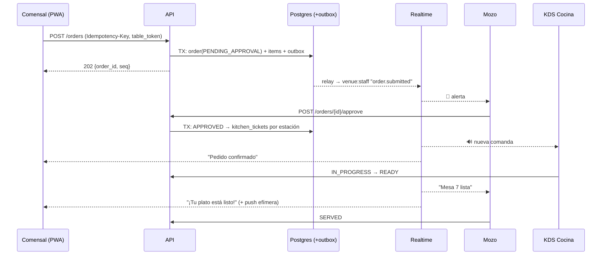
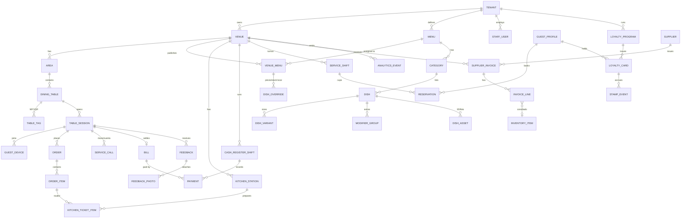

# 🍽️ Plan Maestro: Plataforma de Experiencia en Mesa (Bar)

Base de conocimiento del proyecto **bar**: une una carta interactiva 3D/AR con sistema operativo gastronómico (estilo *Menuly*) y un hub en mesa "zero-install" con NFC + QR (estilo *Candour*).

> Estado: **Fase 0 (diseño + estructura)**. Todavía no hay código. Este documento es la fuente de verdad: cada decisión nueva se agrega acá o como ADR en `docs/adr/`.

---

## Índice

0. [Contexto del Portafolio y qué reutilizamos](#0-contexto-del-portafolio-y-qué-reutilizamos)
1. [Stack tecnológico](#1-stack-tecnológico)
2. [Estrategia "no-app pero sí-app"](#2-estrategia-no-app-pero-sí-app)
3. [Pipeline 3D y WebAR](#3-pipeline-3d-y-webar)
4. [Motor de tiempo real](#4-motor-de-tiempo-real)
5. [Modelo de datos multi-tenant](#5-modelo-de-datos-multi-tenant)
6. [IA y seguridad en mesa](#6-ia-y-seguridad-en-mesa)
7. [Roadmap por fases](#7-roadmap-por-fases)
8. [Estructura de carpetas](#8-estructura-de-carpetas)
9. [Convenciones y próximos pasos](#9-convenciones-y-próximos-pasos)

---

## 0. Contexto del Portafolio y qué reutilizamos

Proyectos hermanos en `Portafolio/`:

| Proyecto | Repo | Stack | Qué tomamos para **bar** |
| :-- | :-- | :-- | :-- |
| **Enterprice-portafolio** | `agustinamade6-dev/Enterprice-portafolio` | Next.js 16, React 19, TS, Tailwind v4, Zod, jose, Cloudflare | Base del **frontend**: Next.js App Router, Tailwind v4, validación con Zod, JWT con `jose`, headers estrictos (`_headers`), validación de uploads (sin SVG/HTML). |
| **taller (LV Racing)** | `NicBazan/lv-racing-web` | FastAPI, SQLAlchemy async, Jinja2, SlowAPI, Vercel | Lecciones de **seguridad y mobile**: cookies `HttpOnly` borradas solo desde el servidor, `overflow-x: clip`, guards en el servidor, rate limiting, ocultar Swagger en producción, estáticos fuera de Python (ver `taller/LECCIONES-APRENDIDAS.md`). |
| **crm-frontend** | `NicBazan/crm-frontend` | React 19 + Vite + Tailwind v4 | Patrones de panel (tablas, Kanban) para el admin, KDS y mozo. |
| **chatbot** | `NicBazan/CRM` | FastAPI + Alembic + Pytest | Experiencia con asistentes conversacionales, que sirve de referencia para el Chef IA. |
| **todo suela** | `NicBazan/Todo-suela` | FastAPI + Docker + Render | Referencia de deploy con Docker y Render. |
| **leading-page** | `agustinamade6-dev/leading-page` | HTML + video, scroll | Ideas de landing comercial (scrollytelling) para vender el producto. |

**Decisión:** el ecosistema fuerte en frontend es **Next.js + TS** (Enterprice). Por eso **bar** es un **monorepo TypeScript** de punta a punta: comparte tipos entre API, PWA y paneles. Python (FastAPI) queda solo como opción para workers de IA o 3D si alguna librería lo exige.

---

## 1. Stack tecnológico

### Arquitecturas evaluadas

| Criterio | **A. Monolito modular TS + realtime gestionado** ✅ | B. Microservicios (Go/Elixir + K8s) | C. BaaS puro (Firebase/Supabase) |
| :-- | :-- | :-- | :-- |
| Time-to-market | Muy alto | Bajo | Muy alto |
| Latencia en mesa | Buena (edge + CDN) | Excelente | Media (cold starts, lógica en el cliente) |
| Costo con 10 locales | Muy bajo | Alto | Muy bajo |
| Costo con 2.000 locales | Bajo/medio | Medio | Impredecible |
| Transacciones (cupos, caja, comandas) | Fuerte (Postgres) | Fuerte | Débil |
| Lock-in | Bajo | Bajo | Alto |

**Por qué A:** el problema no es de CPU. Lo que importa es la **consistencia transaccional** (cupos, comandas sin duplicar, caja) y **iterar rápido con locales reales**. B es sobre-ingeniería hasta superar unos 5k locales.

### Stack ganador

| Capa | Elección |
| :-- | :-- |
| Web comensal (PWA) | **Next.js (App Router)**, carta en ISR/estático en CDN, Service Worker offline |
| Paneles (mozo, KDS, admin, caja) | Next.js en una app separada del monorepo, KDS como PWA en modo kiosco |
| Nativo | **App Clip iOS (SwiftUI)**, un shell fino con WebView. **Android sin binario** (Google Play Instant fue discontinuado en 2025) |
| Backend | **Node.js + TypeScript (NestJS o Fastify)** en módulos por dominio |
| Base de datos | **PostgreSQL** (Neon/Supabase/RDS) + **Row-Level Security por `tenant_id`** |
| ORM / migraciones | Prisma o Drizzle (decidir en un ADR) |
| Caché / efímero | **Redis** (Upstash): rate limit, tokens de mesa, pub/sub |
| Colas | **BullMQ** (fases 1–3), luego SQS/Temporal |
| Tiempo real | **Ably** (gestionado), luego **Centrifugo** propio |
| Archivos / 3D | **Cloudflare R2 + CDN** (sin costo de egress) |
| Hosting | API: Fly.io/Railway/ECS (región `sa-east-1`). Front: Vercel o Cloudflare Pages |
| Analítica | PostHog, luego ClickHouse |
| Observabilidad | OpenTelemetry + Sentry |

**Principio de latencia:** la carta se puede **leer sin backend** (CDN + caché del Service Worker). Las acciones (pedir, llamar al mozo) salen por una **outbox local con reintentos idempotentes** (`Idempotency-Key`).

---

## 2. Estrategia "no-app pero sí-app"

### Realidad de plataformas (octubre de 2026)
- **Android:** Google Play Instant está discontinuado, así que la experiencia es **100 % PWA** más capacidades nativas del sistema operativo.
- **iOS App Clip:** límite de **15 MB** para invocación física (NFC/QR). Los 50 MB aplican solo a invocación digital.

### Qué vive dónde

| Módulo | PWA | App Clip iOS |
| :-- | :-- | :-- |
| Carta, 3D, AR (Quick Look funciona desde Safari) | ✅ | ✅ (WebView) |
| Pedidos, mozo, cuenta, Chef IA, juegos, feedback, reseñas | ✅ | ✅ (WebView) |
| **Wi-Fi en un toque** | ⚠️ Fallback | ✅ `NEHotspotConfigurationManager` |
| **Push "tu plato está listo"** | Limitado en iOS | ✅ notificaciones efímeras (8 h) |
| Sellos de fidelización | ✅ + pase de Apple/Google Wallet | ✅ |

El App Clip (menos de 5 MB) lee la URL de invocación, conecta al Wi-Fi, registra la push efímera y muestra la PWA en `WKWebView`, con un **bridge JS↔nativo**.

### Wi-Fi
- **iOS (Clip):** `NEHotspotConfiguration(ssid:passphrase:isWEP:false)`. Requiere el entitlement *Hotspot Configuration*. ⚠️ **Spike obligatorio:** validar que Apple lo aprueba dentro del target App Clip. Las credenciales vienen de `GET /v1/venues/{id}/wifi` con el token de mesa, nunca en la URL.
- **Android:** QR Wi-Fi impreso en la tarjeta (`WIFI:T:WPA;S:<ssid>;P:<pass>;;`). La cámara nativa lo entiende, también en iOS. El NFC lleva siempre la URL (una lectura dispara un solo intent).
- **Fallback web:** botón "Copiar contraseña" más instrucciones. La web no tiene API para unirse a redes Wi-Fi.
- **Red de invitados aislada** (client isolation) con clave rotada desde el panel.

### Ruteo desde el tag/QR
```
https://m.<dominio>/t/{tag_code}     # tag_code: base62 aleatorio de 10-12 chars
```
- iOS: `apple-app-site-association` + *Advanced App Clip Experience* con prefijo `/t/`. Sin Clip, abre Safari en la misma URL.
- El edge resuelve `tag_code → {tenant, venue, table, status}` (cacheado en KV) y emite el **token de sesión de mesa**.
- Tags remapeables desde el panel (mover, desactivar o reasignar sin reimprimir).
- **NTAG 424 DNA (SUN/SDM):** en cada toque añade contador + CMAC (`?e=..&c=..`) y sirve como prueba de presencia física.

---

## 3. Pipeline 3D y WebAR

### Cliente
- **`<model-viewer>`** con `ar-modes="webxr scene-viewer quick-look"`: `src=.glb` (Android) y `ios-src=.usdz` (iOS, pre-generado).
- Escala real 1:1, colocación sobre la mesa.
- Carga progresiva: póster AVIF/WebP, luego LOD1 (~400 KB) y LOD0 solo bajo demanda. **Nunca precargar el 3D de toda la carta.**

### Presupuesto

| Activo | Objetivo |
| :-- | :-- |
| GLB LOD0 (AR) | ≤ 1,5 MB · 20–50k triángulos |
| GLB LOD1 (preview) | ≤ 400 KB · 5–10k triángulos |
| USDZ | ≤ 3 MB (sin Draco ni KTX2, texturas JPEG 1024–2048) |
| Texturas | KTX2/Basis (UASTC para normales, ETC1S para albedo) |
| Geometría | Meshopt (Draco opcional) |

Herramientas: **gltf-transform** (`simplify`, `meshopt`, `ktx2`, `resize`, `dedup`, `prune`) y `usdzconvert`/Blender headless.

**CDN:** R2 con URL inmutable por hash (`/3d/{sha}.glb`), `Cache-Control: public, max-age=31536000, immutable`. Objetivo: **primer frame 3D en menos de 2 s en 4G**.

### Creación de activos
1. **Captura:** 60–120 fotos o video 4K con base giratoria (guía en la app del dueño).
2. **Reconstrucción:** fotogrametría (Apple Object Capture en un Mac mini, o RealityScan) para obtener **malla** (que es lo que pide AR). *Gaussian Splatting* solo para el visor in-page premium (fase 4), porque no es compatible con Quick Look ni Scene Viewer.
3. **Limpieza automática:** segmentar la base, centrar, apoyar en Y=0, escalar por el diámetro real, decimar y hornear texturas.
4. **QA humano** (aprobar / recortar / rechazar).
5. **Publicar:** LOD0, LOD1, USDZ y póster, con hash.

Estados del job: `uploaded → reconstructing → cleaning → qa → published | rejected` (código en `apps/workers/src/jobs/asset-3d` + `tools/3d-pipeline`).

---

## 4. Motor de tiempo real

| Opción | Uso |
| :-- | :-- |
| SSE / Ably | **Comensal**: pocos eventos y en un solo sentido. Las acciones van por POST idempotente |
| WebSocket con presencia (Ably → Centrifugo) | **Mozo y KDS** |
| MQTT | Solo para hardware (timbres, impresoras) |

**Reglas:**
- **La verdad vive en Postgres**, el canal solo notifica.
- **Secuencia monotónica por sucursal** (`venue_seq`). Al reconectar: `GET /state?since=<seq>`.
- **Transactional outbox:** la misma transacción escribe en `outbox_event` y un relay publica al broker.

**Canales:** `venue:{id}:staff` · `venue:{id}:kitchen:{station}` · `table_session:{id}` (tokens con capabilities: el comensal solo accede a su mesa).

### Flujo de una orden


**Estados de `order_item`:** `PENDING_APPROVAL → APPROVED → FIRED → IN_PROGRESS → READY → SERVED`, con salidas a `REJECTED` o `VOIDED` (con motivo y usuario para auditoría).

**KDS:** Service Worker + IndexedDB (sigue funcionando sin red y encola los bumps), botón "Iniciar turno" para desbloquear el audio y Wake Lock API.

---

## 5. Modelo de datos multi-tenant

- Base compartida + `tenant_id` en todas las tablas + **RLS**.
- Carta en dos niveles: `MENU` (marca) + `DISH_OVERRIDE` por sucursal (precio, stock, ocultar). Clonar carta = copiar o heredar.
- Precios en **céntimos enteros** + `currency`. `ORDER_ITEM` guarda un **snapshot** del nombre y el precio.
- Cupos: `SERVICE_SHIFT` con `CHECK (booked <= capacity)` + `SELECT … FOR UPDATE`.
- Comensal anónimo (`GUEST_DEVICE`). `GUEST_PROFILE` solo existe si deja su email o teléfono (minimización de datos personales).



Tablas transversales: `outbox_event`, `audit_log`, `layout_theme` (JSONB: Clásico/Reels/Lista), `ai_conversation` (con TTL).

---

## 6. IA y seguridad en mesa

### Chef IA (B2C)
- **Sin RAG vectorial:** la carta entra en el contexto (5–15k tokens).
- **Prefijo cacheado** (instrucciones + JSON del menú versionado) y la conversación al final. Con *prompt caching*, el costo por consulta baja un orden de magnitud.
- Modelo chico y rápido (clase Haiku) con streaming.
- **Cero alucinaciones por construcción:** el modelo llama a `recommend(dish_ids[], reason)`, el backend valida contra la carta y el stock y la UI renderiza tarjetas reales. El modelo **nunca escribe precios**.
- Alérgenos como campos estructurados. Con alergias graves, la respuesta fija es "confirmá con el mozo".

### Facturas de proveedores (B2B)
```
Foto → R2 → cola → Vision con JSON estricto
→ validaciones deterministas (Σ líneas, IVA, CUIT, duplicados)
→ matching de líneas con el inventario (alias aprendido → fuzzy/embeddings → LLM con candidatos)
→ baja confianza ⇒ bandeja "Revisar" → confirmar ⇒ gasto + stock + costo + alias aprendido
```
Alertas de suba de precios y recálculo del food cost.

### Anti-trolling sin registro (en capas)
1. **Presencia física:** NFC con NTAG 424 SUN (anti-replay) + señal de IP del Wi-Fi del local.
2. **Sesión de mesa aprobada:** el mozo la abre, o se abre sola con un NFC SUN válido. Los demás comensales se unen con **PIN de 4 dígitos**. Se cierra al pagar.
3. **Token de mesa:** JWT corto en cookie `HttpOnly` + `SameSite`, rotado al reabrir la mesa.
4. **Gating por acción:** la carta es libre. Chef IA con cuota. Llamar al mozo con cooldown de 60–90 s y deduplicación. **Los pedidos requieren aprobación del mozo.**
5. **Rate limit en Redis** por dispositivo, mesa, IP y sucursal, más circuit breaker por mesa.
6. **Fingerprint liviano** para correlacionar abuso, no como identidad. Cloudflare Turnstile en feedback y reservas.
7. **Fotos del feedback:** URL prefirmada + moderación automática.

---

## 7. Roadmap por fases

### Fase 0: spikes de riesgo (2–3 semanas) ← **estamos acá**
- [x] Blueprint y estructura de carpetas
- [ ] App Clip + `NEHotspotConfiguration` (¿aprobación de Apple?)
- [ ] NTAG 424 + verificación de SUN en el servidor
- [ ] Capturar 10 platos, medir tiempos y pesos
- [ ] 3D en 4G real dentro de un local (Android gama baja + iPhone viejo)

### Fase 1: MVP "carta viva + pedidos" (8–10 semanas), 3–5 locales piloto
- Monorepo, Postgres + RLS, auth de staff, un local y una sucursal.
- Admin de carta, un layout, ruteo QR/NFC, PWA offline.
- Sesión de mesa + aprobación del mozo + pedidos + **panel de mozo** + **KDS con sonido**.
- Llamar al mozo / pedir la cuenta, analítica base, 3D cargado a mano.

### Fase 2: diferenciación (8 semanas)
- Chef IA, layouts Clásico/Reels/Lista en vivo.
- Sellos + Wallet, deep link a Google Reviews (sin *review gating*), feedback con fotos, minijuegos.
- App Clip v1 (Wi-Fi + push efímera), pipeline 3D semiautomático.

### Fase 3: sistema operativo del local (10 semanas)
- Reservas con cupo y lista de espera.
- Caja (turnos, división de cuenta, cierre Z), pagos (Mercado Pago/Stripe), facturación fiscal mediante un proveedor (ARCA).
- Facturas con IA + inventario + food cost.
- Multi-sucursal con clonación de carta, dashboards de conversión.

### Fase 4: escala
- Centrifugo, Temporal, ClickHouse, particionado.
- Gaussian Splatting, captura 3D autoservicio, integraciones POS, impresoras, QR dinámico e-ink.
- Extraer solo los servicios con más carga.

---

## 8. Estructura de carpetas

```
bar/
├── PLAN-MAESTRO.md            ← este documento
├── README.md
├── apps/
│   ├── guest-web/             PWA del comensal (Next.js)
│   │   ├── public/            manifest, íconos, service worker
│   │   └── src/
│   │       ├── app/           rutas: /t/[tag], /v/[venue]/menu, ...
│   │       ├── features/
│   │       │   ├── menu/          carta + layouts (Clásico/Reels/Lista)
│   │       │   ├── ar-viewer/     <model-viewer>, LODs
│   │       │   ├── ordering/      carrito, outbox local idempotente
│   │       │   ├── service-calls/ llamar al mozo / pedir la cuenta
│   │       │   ├── chef-ai/       chat en streaming + tarjetas validadas
│   │       │   ├── loyalty/       sellos, Wallet
│   │       │   ├── feedback/      buzón anónimo + fotos
│   │       │   ├── games/         sudoku (lazy-load)
│   │       │   └── wifi/          fallback web + bridge con App Clip
│   │       └── lib/
│   ├── staff-web/             Paneles (Next.js)
│   │   └── src/app/
│   │       ├── waiter/        mozo: aprobaciones, llamados
│   │       ├── kds/           cocina por estación
│   │       ├── admin/         carta, mesas/tags, layouts, analítica
│   │       └── cash/          caja
│   ├── api/                   Backend modular (NestJS/Fastify)
│   │   └── src/
│   │       ├── modules/       catalog, venues, table-session, ordering, kitchen,
│   │       │                  service-calls, reservations, loyalty, feedback,
│   │       │                  cash, procurement, ai, analytics
│   │       └── shared/        db (RLS), auth, realtime, outbox, rate-limit
│   ├── workers/               Jobs (BullMQ)
│   │   └── src/jobs/          invoice-ocr, asset-3d, outbox-relay, notifications
│   └── ios-appclip/           App Clip SwiftUI (Fase 2)
├── packages/
│   ├── db/                    esquema, migraciones, seed
│   ├── shared-types/          DTOs + esquemas Zod compartidos
│   ├── ui/                    design system
│   ├── config/                eslint, tsconfig base
│   ├── realtime-client/       wrapper de suscripción + catch-up por seq
│   └── ai-prompts/            prompts versionados del Chef IA y OCR
├── infra/
│   ├── docker/                docker-compose: postgres + redis local
│   ├── edge/                  resolver /t/{tag_code}
│   └── well-known/            apple-app-site-association, assetlinks.json
├── tools/
│   ├── 3d-pipeline/           scripts gltf-transform / usdz
│   └── nfc/                   grabado de tags, verificación SUN
└── docs/
    ├── adr/                   decisiones de arquitectura (0001-...)
    └── diagrams/
```

---

## 9. Convenciones y próximos pasos

### Convenciones
- **Gestor:** pnpm workspaces + Turborepo. Node 22 LTS. TypeScript `strict`.
- **Validación:** Zod en `packages/shared-types`, compartido entre el front y la API (como en Enterprice).
- **Seguridad heredada de taller y Enterprice:** headers estrictos, `HttpOnly` borrado solo en el servidor, Swagger oculto en producción, uploads sin SVG/HTML, `overflow-x: clip` en mobile, `noindex` en paneles.
- **Dinero:** enteros en céntimos. **Fechas:** UTC en la base, zona horaria de la sucursal en la UI.
- **Idempotencia:** toda mutación del comensal lleva `Idempotency-Key`.
- **ADR:** toda decisión no trivial va en `docs/adr/NNNN-titulo.md`.

### Próximos pasos (inicio de la codificación)
1. ✅ Monorepo pnpm + Turborepo (`packages/config` con el tsconfig base).
2. ✅ `infra/docker/docker-compose.yml`: Postgres 17 (puerto **5433**) + Redis 7 (puerto **6380**).
3. ✅ `packages/db` (**Prisma**): esquema de la Fase 1, migración `fase1_init` y seed de un bar demo (8 mesas con tag QR, carta de 11 platos, staff por rol). Correr con `pnpm infra:up`, `pnpm db:migrate` y `pnpm db:seed`.
4. ✅ `apps/api` (**Fastify 5 + Zod + jose**): módulos `catalog`, `table-session`, `ordering`, `kitchen`, `service-calls`, `staff` + outbox transaccional + catch-up `/v1/state`. Test e2e del flujo completo (`pnpm --filter @bar/api test`). Detalle en [§10](#10-api-fase-1-implementada).
5. ✅ `apps/guest-web` (**Next.js 16 + Tailwind v4**): `/t/[tag]` → unirse (con PIN si la mesa ya está abierta) → carta por categorías → ficha del plato (variantes, modificadores, nota) → carrito persistente → pedido idempotente con reintentos → estado en vivo (polling a `/state` cada 4 s y al volver a la pestaña o recuperar red) → llamar al mozo / pedir la cuenta. Correr con `pnpm --filter @bar/guest-web dev` (puerto 3000).
6. ✅ `apps/staff-web` (**Next.js 16**, puerto 3001):
   - `/login`.
   - `/waiter`: llamados (Voy / Listo), pedidos por confirmar (confirmar o rechazar con motivo), platos listos para llevar (Servido) y mesas (abrir, descartar, cerrar).
   - `/kds`: comandas por estación agrupadas por pedido, tiempo de espera con colores (10′ / 20′), Empezar / Listo / Todo listo.
   - Botón "🔔 Iniciar turno": desbloquea el sonido (Web Audio) y mantiene la pantalla encendida (Wake Lock). Polling a `/state` cada 3 s.
   - OWNER y MANAGER pueden pasar de Salón a Cocina.
7. Prueba de punta a punta: escanear QR → pedir → aprobar → KDS → listo.

### ADRs pendientes
- ~~0001: NestJS vs Fastify~~ → **Fastify** (más liviano; los módulos son plugins por dominio)
- ~~0002: Prisma vs Drizzle~~ → **Prisma** (migraciones + Studio; SQL a mano para índices parciales y RLS)
- 0003: Ably vs Centrifugo desde el día 1
- 0004: hosting de la API (Fly.io vs Railway vs ECS)

---

## 10. API Fase 1 (implementada)

Correr local:
```bash
pnpm infra:up && pnpm db:migrate && pnpm db:seed   # el seed imprime las URLs /t/{code} de cada mesa
pnpm --filter @bar/api dev                          # http://localhost:4000
```
Staff demo: `dueno@`, `mozo@`, `cocina@`, `caja@bardemo.test` (contraseña de desarrollo en `packages/db/prisma/seed.ts`).

### Endpoints (`/v1`)

| Método | Ruta | Quién | Qué hace |
| :-- | :-- | :-- | :-- |
| GET | `/tags/:code` | público | Resuelve local y mesa del QR/NFC |
| GET | `/venues/:venueId/menu` | público (cacheable) | Carta compilada con overrides de la sucursal |
| POST | `/tags/:code/session` | comensal | Une el dispositivo a la mesa. El primero crea la sesión `PENDING` y recibe el PIN; los demás necesitan el PIN |
| GET | `/session` | comensal | Estado de la mesa, pedidos y llamados (410 si está cerrada) |
| POST | `/orders` | comensal | Pedido con `Idempotency-Key`; precios y estación calculados en el servidor |
| POST | `/service-calls` | comensal | `WAITER` / `BILL`, deduplicado y con cooldown de 60 s |
| GET | `/state?since=seq` | comensal / staff | Catch-up de eventos del outbox |
| POST | `/staff/login` · `/staff/logout` | staff | JWT (Bearer o cookie HttpOnly) |
| GET | `/staff/sessions` · POST `/staff/sessions/:id/open\|close` | mozo | Abrir y cerrar mesas |
| GET | `/staff/orders` · POST `/staff/orders/:id/approve\|reject` | mozo | Aprobar manda los ítems a cocina (`FIRED`) |
| GET | `/staff/kitchen/items?station=` · PATCH `/staff/order-items/:id/status` | cocina / mozo | KDS: `IN_PROGRESS → READY` (cocina), `SERVED` (mozo), `VOIDED` (encargado, con auditoría) |
| GET | `/staff/service-calls` · POST `/staff/service-calls/:id/ack\|resolve` | mozo | Atender llamados |

### Decisiones tomadas en el código
- **Una sesión activa por mesa:** índice único parcial (`WHERE status <> 'CLOSED'`). Si dos celulares escanean a la vez, uno reintenta y se une a la misma sesión.
- **Outbox:** cada evento incrementa `Venue.eventSeq` dentro de la transacción y se escribe en un canal (`venue:{id}:staff`, `venue:{id}:kitchen`, `table_session:{id}`).
- **Aislamiento:** todas las consultas de staff filtran por `tenantId` (+ `venueId` si el usuario está atado a una sucursal).
- **Rate limit:** global de 300/min por IP; login 10/min; pedidos 10/min **por dispositivo** (la mesa comparte IP).

### Pendiente de la API
- Relay del outbox → broker (Ably/SSE) en `apps/workers` (hoy el front puede hacer polling a `/state`).
- Store de rate limit en Redis. RLS en Postgres como segunda barrera.
- Verificación SUN de NTAG 424 en `POST /tags/:code/session`.
