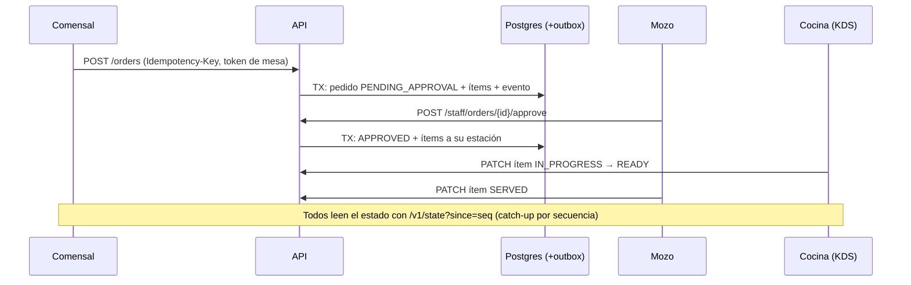

# Arquitectura

Referencia técnica de la plataforma. La estrategia, el estado y la hoja de ruta están en [PLAN-MAESTRO.md](../PLAN-MAESTRO.md); cómo correrlo, en [DESARROLLO-LOCAL.md](DESARROLLO-LOCAL.md); la seguridad, en [SEGURIDAD.md](SEGURIDAD.md).

## 1. Visión general

Monolito modular en TypeScript, de punta a punta, en un monorepo pnpm + Turborepo.

| Componente | Tecnología | Responsabilidad |
| :-- | :-- | :-- |
| `apps/guest-web` | Next.js 16 (App Router), Tailwind v4 | Carta del comensal (QR/NFC, 3D/AR, pedidos, Mi cuenta) |
| `apps/staff-web` | Next.js 16, Tailwind v4 | Paneles: login, salón (mozo), cocina (KDS), admin del bar, super admin |
| `apps/api` | Fastify 5, Zod 4, jose | API REST `/v1`, módulos por dominio |
| `apps/workers` | Node + BullMQ | Relay del outbox y tareas en segundo plano |
| `packages/db` | Prisma 6 + PostgreSQL 17 | Esquema, migraciones y seed |
| `packages/shared-types` | TypeScript + Zod | Tipos compartidos |
| Archivos | Cloudinary (o disco local en desarrollo) | Fotos, logos y modelos 3D |
| Caché / colas | Redis | Colas de BullMQ |

**Por qué un monolito modular:** el problema no es de cómputo sino de consistencia (comandas sin duplicar, cuotas, canjes, caja) y de velocidad para iterar con locales reales. Postgres da transacciones fuertes y un solo despliegue mantiene el costo bajo. Microservicios o un BaaS puro no se justifican antes de miles de locales.

**Front → API:** el navegador siempre llama a `/v1/*` en su propio dominio y Next lo reenvía a la API (`rewrites`). Así no hay CORS en el uso normal y la cookie del staff es de primera parte.

## 2. Flujo de un pedido



Estados de un ítem: `PENDING_APPROVAL → APPROVED → FIRED → IN_PROGRESS → READY → SERVED`, con salidas a `REJECTED` o `VOIDED` (con motivo y usuario).

## 3. Tiempo real

- **La verdad vive en Postgres**; el canal solo avisa.
- **Outbox transaccional:** cada cambio escribe un evento en la misma transacción e incrementa `Venue.eventSeq`. El worker marca `publishedAt`; los eventos se purgan a las 24 h.
- **Hoy:** los clientes consultan `/v1/state?since=<seq>` cada 3–4 s. Alcanza para el piloto y no tiene costo extra.
- **Cuando haga falta** (decenas de locales activos a la vez): SSE propio sobre el mismo outbox. Ably o Centrifugo solo si SSE no alcanza.

## 4. Datos

- Base compartida con `tenantId` en todas las tablas; el `tenantId` sale siempre del token, nunca del cliente.
- Carta en dos niveles: menú de la marca + ajustes por sucursal (precio, agotado, oculto).
- Dinero en enteros (`*Cents`) + `currency`. El ítem del pedido guarda una copia del nombre y del precio.
- Una sesión activa por mesa (índice único parcial `WHERE status <> 'CLOSED'`).
- Comensal anónimo por dispositivo; el cliente identificado ("Mi cuenta") existe solo si deja su email, y es una cuenta por bar.
- Fidelización como libro de movimientos (`LoyaltyEvent`): el saldo es la suma, nunca se pisa.

## 5. Seguridad en la mesa (sin registro)

1. **Presencia física:** NFC NTAG 424 con SUN (NXP AN12196, anti-replay y UID ligado a la mesa). El QR requiere que el mozo abra la mesa.
2. **Sesión de mesa:** los demás comensales se suman con un PIN de 4 dígitos (8 fallos → bloqueo). Se cierra al pagar o vence sola si queda abandonada.
3. **Gating por acción:** la carta es libre; pedir requiere aprobación del mozo; llamar al mozo tiene enfriamiento de 60 s.
4. **Rate limit** por dispositivo, cuenta y email; onboarding con tope global.

Detalle de los 24 puntos revisados en [SEGURIDAD.md](SEGURIDAD.md).

## 6. 3D y AR

- `<model-viewer>` con `ar-modes="webxr scene-viewer quick-look"`: GLB para Android y USDZ para iOS.
- Carga progresiva: primero el póster y después el modelo, nunca el 3D de toda la carta junto.
- Presupuesto por plato: GLB ≤ 1,5 MB y USDZ ≤ 3 MB. La compresión automática (`gltf-transform`) está pendiente.
- Los modelos los sube el bar o un proveedor externo. No se construye un pipeline propio de fotogrametría (ver el plan, sección de alcance).

## 7. Estructura del repositorio

```
bar/
├── apps/
│   ├── api/            módulos: admin, billing, catalog, customers, kitchen, loyalty, onboarding,
│   │                   ordering, promotions, service-calls, staff, superadmin, table-session, venues
│   ├── guest-web/      carta del comensal
│   ├── staff-web/      paneles del local y de la plataforma
│   └── workers/        relay del outbox
├── packages/
│   ├── db/             Prisma: esquema, migraciones, seed, create-superadmin
│   ├── shared-types/
│   └── config/         tsconfig base
├── infra/docker/       docker-compose (Postgres + Redis), Dockerfile de la API
├── scripts/mvp/        MVP local con un clic y prueba de humo
└── docs/
```

## 8. Convenciones

- pnpm + Turborepo, Node 22+, TypeScript `strict`.
- Zod en el borde de la API. Con Zod 4, los esquemas de PATCH van sin `.default()` (se aplican aunque el campo falte).
- Dinero en centavos; fechas en UTC en la base y en la zona horaria de la sucursal en la UI.
- Toda mutación del comensal lleva `Idempotency-Key`.
- Sin APIs exclusivas de HTTPS en el front (el MVP corre por HTTP en la red local): usar `uuid()` de `lib/storage.ts`.
- Archivos validados por contenido; solo URLs `https://` o archivos propios.
- Decisiones no triviales en `docs/adr/NNNN-titulo.md`.

### Decisiones tomadas

| Tema | Decisión | Motivo |
| :-- | :-- | :-- |
| Framework de la API | Fastify | Más liviano que NestJS; los módulos son plugins por dominio |
| ORM | Prisma | Migraciones y Studio; SQL a mano para índices parciales |
| Tiempo real | Polling a `/v1/state` sobre outbox | Costo cero y suficiente para el piloto |
| Archivos | Cloudinary | Plan gratuito, CDN incluido, sin disco en el servidor |
| Cuenta del cliente | Email con código, una cuenta por bar | Sin contraseñas ni Apple Wallet |
| Cuota del plan gratuito | Se consume al abrir la mesa | No se cobra por escaneos sin consumo |
| Estado del staff | Se lee de la base en cada request (caché de 10 s) | Bajas, cambios de rol y suspensiones aplican enseguida |

## 9. API

### Comensal y salón (`/v1`)

| Método | Ruta | Quién | Qué hace |
| :-- | :-- | :-- | :-- |
| GET | `/tags/:code` | público | Resuelve el local y la mesa del QR/NFC |
| GET | `/venues/:venueId/menu` | público (cacheable) | Carta compilada con los overrides de la sucursal |
| GET | `/media/:tenant/:file` | público | Fotos y modelos 3D subidos (nombres generados por el servidor) |
| POST | `/tags/:code/session[?uid&ctr&cmac]` | comensal | Une el dispositivo a la mesa. QR: el primero crea la sesión `PENDING` y los demás necesitan el PIN (8 fallos → bloqueo); un dispositivo que ya estaba entra sin PIN. NFC SUN válido: abre la mesa directo |
| GET | `/session` | comensal | Estado de la mesa, pedidos, llamados y hub (Wi-Fi solo con la mesa abierta, link de reseñas) |
| POST | `/orders` | comensal | Pedido con `Idempotency-Key`; precios y estación los calcula el servidor. Reglas: 40 unidades por pedido, 3 sin confirmar, 120 unidades por hora y pedido repetido en 3 min → 409 `DUPLICATE_ORDER` (reenviar con `confirmDuplicate`) |
| GET | `/session/receipt` | comensal | Cuenta provisoria o comprobante final (también con la mesa cerrada) |
| GET | `/staff/sessions/:id/receipt` | mozo / caja | Lo mismo, desde el panel |
| GET | `/customer/me/visits/:id/receipt` | cliente | Comprobante de una visita propia |
| POST | `/service-calls` | comensal | `WAITER` / `BILL`, deduplicado y con cooldown de 60 s |
| GET | `/state?since=seq` | comensal / staff | Catch-up de eventos del outbox |
| POST | `/onboarding/register` | público | Alta self-service de un bar (tope global de 30 por hora) |
| POST | `/staff/login` · `/staff/logout` | staff | JWT; 10 intentos por minuto por cuenta |
| GET | `/staff/sessions` · POST `/staff/sessions/:id/open\|close\|new-pin` | mozo | Abrir (consume cuota), cerrar (cancela pedidos sin confirmar) y PIN nuevo |
| GET | `/staff/orders` · POST `/staff/orders/:id/approve\|reject` | mozo | Aprobar manda los ítems a cocina |
| GET | `/staff/kitchen/items` · PATCH `/staff/order-items/:id/status` | cocina / mozo | KDS |
| GET | `/staff/service-calls` · POST `/staff/service-calls/:id/ack\|resolve` | mozo | Atender llamados |

### Cliente: "Mi cuenta" (`/v1/customer`, token de cliente por Bearer, una cuenta por bar)

| Método | Ruta | Qué hace |
| :-- | :-- | :-- |
| POST | `/customer/auth/request-code` | `{venueId, email}` → código de 6 dígitos por email (vence a los 10 min; 1 cada 30 s; 5 cada 15 min por email y bar). Misma respuesta exista o no la cuenta |
| POST | `/customer/auth/verify` | `{venueId, email, code, name?, acceptPrivacy?, guestToken?}` → token de 90 días. La primera vez exige `acceptPrivacy`. Con `guestToken` vincula la visita actual. 5 intentos por código |
| POST | `/customer/link` | Vincula la mesa actual (`guestToken` del mismo bar) a la cuenta; si la mesa ya cerró, suma los sellos |
| GET/PATCH | `/customer/me` | Perfil y estadísticas (visitas, gasto) / cambiar el nombre |
| GET | `/customer/me/history` | Visitas (sesiones de mesa) con sus pedidos |
| GET | `/customer/me/orders/:id/reorder` | "Pedir lo mismo": el pedido traducido a la carta de hoy (ids actuales; lo agotado vuelve marcado) |
| GET | `/customer/me/loyalty` | Tarjeta: modo, saldo, sumados este mes, premios, próximo premio y movimientos |
| GET · DELETE | `/customer/me/export` · `/customer/me` | Exportar todos los datos (JSON) · borrar la cuenta (los pedidos quedan anónimos) |
| GET | `/customer/promos` · `/venues/:venueId/promos` (público) | Promos vigentes |
| GET · PUT | `/customer/notifications[?endpoint=]` · `/customer/notifications/email` | Preferencias de avisos · opt-in de promos por email |
| POST | `/customer/push/subscribe` · `/customer/push/unsubscribe` | Suscripción Web Push del celular para este bar (solo servicios de push reales) · baja (sin login, por endpoint y bar) |
| POST | `/customer/unsubscribe?t=` | Baja de promos por email en un toque (token firmado del email; acepta el POST one-click de los clientes de correo) |

### Mozo: fidelización

| Ruta | Qué hace |
| :-- | :-- |
| GET `/staff/sessions/:id/customers` | Clientes con cuenta en la mesa (nombre, email enmascarado, saldo y premios) |
| POST `/staff/loyalty/redeem` | Canje `{sessionId, customerId, rewardId}`: el cliente tiene que estar en la mesa; bloqueo de fila contra canjes simultáneos |

### Admin del bar (`/v1/admin`, OWNER y MANAGER)

| Ruta | Qué hace |
| :-- | :-- |
| GET `/admin/overview` | Ventas de 24 h, mesas activas, plan y uso, top 5 platos de 7 días |
| GET `/admin/menu` | Carta completa para editar (incluye archivados y ocultos) |
| POST/PATCH/DELETE `/admin/categories[/:id]` | Categorías (borrar solo si está vacía) |
| POST/PATCH/DELETE `/admin/dishes[/:id]` | Platos; DELETE = archivar (los pedidos viejos lo referencian) |
| PUT `/admin/dishes/:id/availability` | Agotado / oculto / precio local de la sucursal |
| PUT `/admin/dishes/:id/variants` · `/modifier-groups` | Tamaños y grupos de opciones (reemplazo completo) |
| POST/PUT/DELETE `/admin/dishes/:id/media/:kind` | Foto, GLB o USDZ: subida multipart validada o URL https |
| POST `/admin/stations` | Estaciones de cocina (pantallas del KDS) |
| GET/POST/PATCH `/admin/tables[/:id]` · POST `/:id/regenerate-qr` · PUT `/:id/nfc` | Mesas, QR nuevo (invalida el impreso), vincular chip NTAG 424 |
| POST `/admin/areas` | Áreas del salón |
| GET/POST/PATCH `/admin/staff[/:id]` | Equipo con matriz de roles |
| GET/PATCH `/admin/venue` · POST/DELETE `/admin/venue/logo` | Nombre, logo, dirección, Instagram, layout, Wi-Fi de invitados, link de reseñas |
| GET/PUT `/admin/loyalty` | Programa de fidelización: activo, sellos o puntos (`centsPerPoint`), premios (hasta 10) y estadísticas |
| GET/POST/PATCH/DELETE `/admin/promotions[/:id]` | Promociones con vigencia opcional |
| GET/POST `/admin/campaigns` | Avisos (push + email) a `ALL` o `INACTIVE_30`; audiencia por canal; máximo 1 por semana por bar (429 `CAMPAIGN_WEEKLY_LIMIT`) |

### Super admin (`/v1/superadmin`, SUPER_ADMIN del tenant de la plataforma)

| Ruta | Qué hace |
| :-- | :-- |
| GET `/superadmin/stats` | Bares, planes, mesas y pedidos de la plataforma |
| GET `/superadmin/tenants[?q=]` · GET `/:id` | Listado con actividad de 30 días; detalle con equipo y auditoría |
| POST `/superadmin/tenants` | Alta de un bar para un cliente (plan y cuota a elección) |
| PATCH `/superadmin/tenants/:id/subscription` | Plan, cuota, reiniciar uso, extender período |
| POST `/superadmin/tenants/:id/suspend\|unsuspend` | Corta al staff y la carta en el próximo request |
| POST `/superadmin/staff/:id/reset-password` | Contraseña temporal (se muestra una sola vez) |
| GET `/superadmin/audit[?tenantId=]` | Auditoría global |

### Detalles de implementación
- **Una sesión activa por mesa:** índice único parcial (`WHERE status <> 'CLOSED'`).
- **Outbox:** cada evento incrementa `Venue.eventSeq` en la transacción. El worker marca `publishedAt` y no borra (los eventos se purgan a las 24 h).
- **NFC SUN:** algoritmo de NXP con AES-CMAC propio, UID ligado a la mesa y anti-replay atómico.
- **Estado vivo del staff:** `requireStaff` mira la base (caché de 10 s). Las bajas, los cambios de rol y las suspensiones aplican enseguida.
- **Cuota FREE:** se consume cuando la mesa se abre (mozo o NFC), no al escanear.
- **Rate limit:** por dispositivo/usuario con token válido, o por IP; login por cuenta; onboarding con tope global; códigos de "Mi cuenta" por email y bar.
- **Fidelización:** libro de movimientos (`LoyaltyEvent`); el saldo es la suma en la unidad vigente. La visita suma al cerrar la mesa (mozo, o cierre automático por abandono) y es idempotente por cliente y visita. Si el bar cambia de sellos a puntos, el saldo empieza de cero en la unidad nueva.
- **Push por bar:** el navegador tiene un solo endpoint por sitio, así que `PushSubscription` es única por (cliente, endpoint): el mismo celular puede recibir avisos de varios bares y darse de baja de uno solo.
